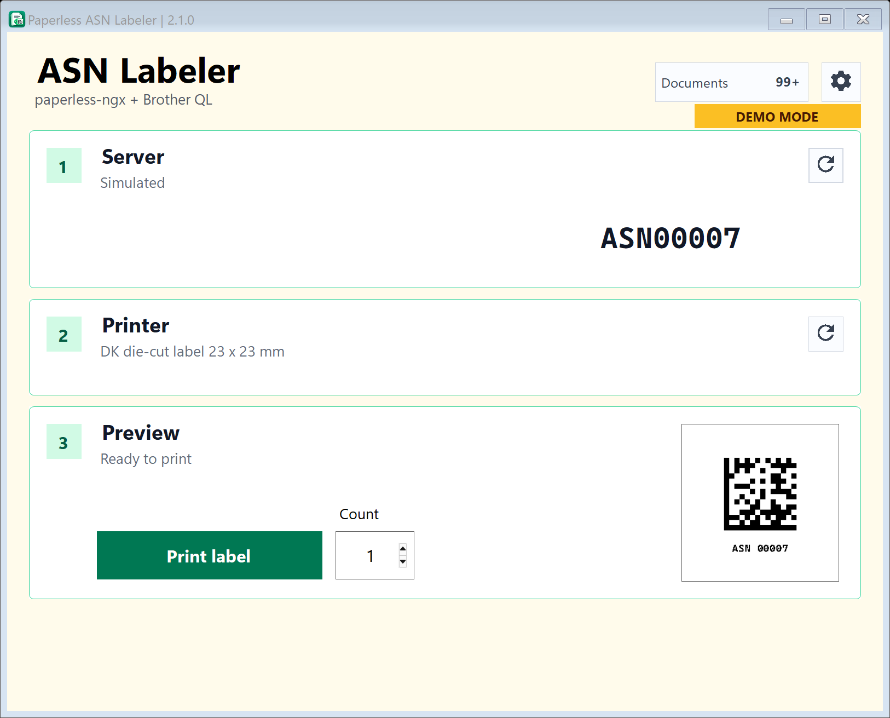
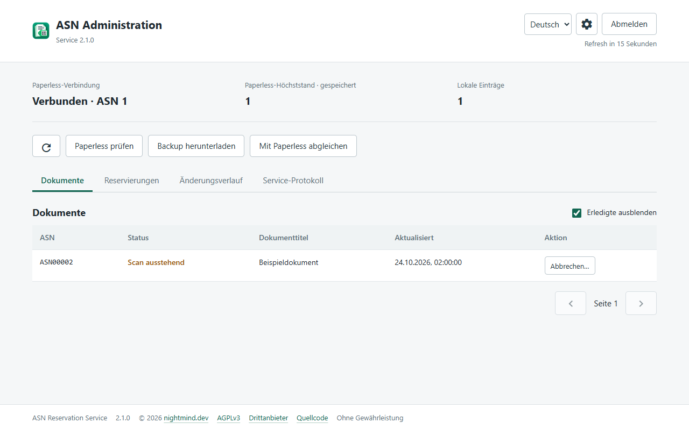

<div align="center">

# ASN Labeler

**Print a label. Scan your document. Find it again.**

DataMatrix labels for **paperless-ngx**, with a Windows client and a self-hosted reservation service.

[](https://github.com/NightmindOfficial/asn-labeler/actions/workflows/ci.yml)
[](LICENSE)
[](#get-started)
[](reservation-service/README.md)

[**Downloads**](https://github.com/NightmindOfficial/asn-labeler/releases) · [**Get started**](#get-started) · [**Documentation**](#documentation) · [**Issues**](https://github.com/NightmindOfficial/asn-labeler/issues)

</div>



*Client in demo mode. Screenshots use synthetic data.*

## From Paper to Paperless

Give paper documents an archive serial number (ASN) before scanning.
ASN Labeler coordinates the next number, prints its DataMatrix label and tracks
whether the document has arrived in Paperless. Host the service wherever you
choose: a home server, VM, cloud host or NAS with Docker.

| Print | Keep Track | Stay in Control |
| --- | --- | --- |
| Brother QL-800 through its existing driver and b-PAC | Outstanding scans, confirmed imports and uncertain prints | Self-hosted service and web administration |
| Die-cut and continuous media; PF-B11221-compatible profile | Multiple clients coordinated through SQLite | Separate client/admin keys and explicit recovery |
| Batches of 1–10, individual cuts and secondary labels | Reconciliation with Paperless | German/English interfaces and optional CLI |

**Sending a print job is not proof of a successful print.** Uncertain results
remain protected until resolved; the app does not automatically reprint them.



*Web admin panel with example data. Client and server versions are independent.*

## Get Started

1. **Host the service:** follow the [Docker deployment guide](reservation-service/README.md).
   Preserve its database volume and `.env` across updates.
2. **Install the client:** download the installer from a
   [client release](https://github.com/NightmindOfficial/asn-labeler/releases?q=client-v).
   Install the Brother driver and official x64 b-PAC separately; the app links
   to setup resources. Enter the service URL and a client API key.
3. **Prepare Paperless:** enable ASN recognition and DataMatrix decoding.
   Follow the [user guide](docs/USAGE.md); the barcode prefix must match.
4. **Print, attach, scan:** the app checks the service, printer and loaded medium
   before printing. Follow outstanding scans in the document list.

### Requirements and Limits

- **Windows x64**, .NET Framework, Brother driver and x64 b-PAC. No Python
  installation needed for the client. Setup is currently unsigned; Windows
  may show a SmartScreen warning.
- **QL-800 via local USB.** QL-810W/QL-820NWB are experimental for diagnostics
  and test prints only, not production ASN printing.
- **Docker Compose** and a reachable Paperless instance with an API token
  able to read the relevant documents. Published images target Linux amd64.
- **One Paperless instance per service.** No document uploads from this app.
  Brother installers and drivers are not redistributed.

## Prefer the Terminal?

Select the optional CLI in Setup, configure the app once, close it, and open
a new terminal:

```powershell
asnlbl help
asnlbl print -c 3
asnlbl print -c 3 -s
```

See the [CLI guide](docs/CLI.md) for flags, exit codes and partial-batch handling.

## Documentation

| Topic | Guide |
| --- | --- |
| Printing and document states | [User guide](docs/USAGE.md) |
| Hosting, configuration and backups | [Service guide](reservation-service/README.md) |
| Command line | [CLI guide](docs/CLI.md) |
| Local builds, tests and contributions | [Contributing](CONTRIBUTING.md) |
| Releases and compatibility | [Release guide](docs/RELEASING.md) |
| Changes | [Client](windows-app/CHANGELOG.md) · [Server](reservation-service/CHANGELOG.md) |
| Reporting vulnerabilities | [Security](SECURITY.md) |

Detailed operating guides are currently in German. Check configuration notes
before updating; do not replace your `.env` with the example file.

## License and Credits

Created by [nightmind.dev](https://nightmind.dev).
[AGPL-3.0-only](LICENSE), with a limited [b-PAC additional permission](LICENSE-BPAC-EXCEPTION.txt)
for the Windows client. Third-party components retain their
[respective licenses](THIRD-PARTY-NOTICES.md). Provided without warranty.

When distributing binaries, provide corresponding source under the applicable
license terms. The service exposes licenses, notices and source at
`/admin/license`, `/admin/notices` and `/admin/source.zip`.

Independent community project; not affiliated with Brother or paperless-ngx.
